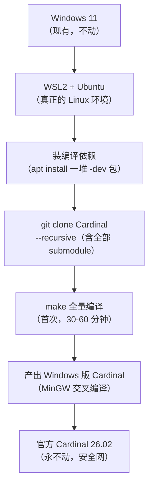

# Cardinal 编译环境 · 前期核查报告

> 生成：2026-09-20
> 目的：**动手前把功课做足，避免实操撞墙**（李的明确要求）
> 结论：**本轮核查推翻了"在 Windows 上直接编译"的方案** —— 详见 §2

---

## 0. 三行结论

1. **Cardinal 官方明确不支持在 Windows 上原生编译**（原文见 §2），因为它需要**符号链接**这个 Windows 做不到的东西。
2. **可走的路只有两条**：① **WSL2（推荐）**；② 在 Linux 机器上交叉编译。
3. **本机条件完全满足 WSL2**：Windows 11 Build 26200 + Hypervisor 已启用。

---

## 1. 本机硬件与系统（实测）

| 项 | 值 | 评价 |
|---|---|---|
| CPU | **Intel Core Ultra 9 275HX** | 24 核 / 24 线程，2700 MHz 基准 |
| 内存 | **31.4 GB** | 充裕 |
| C 盘 | 500 GB（剩 **100.9 GB**） | 够 |
| D 盘 | 451.5 GB（剩 **107.6 GB**） | 够，**编译放这里** |
| 系统 | **Windows 11 家庭版 Build 26200** | ✅ 满足 WSL2 要求（需 1903+） |
| Hypervisor | **Present: True** | ✅ 虚拟化可用 |

## 2. ⚠️ 关键发现：官方不支持 Windows 原生编译

**来源**：DISTRHO/Cardinal 官方 `docs/BUILDING.md`（2026-09-20 WebFetch 逐字确认）：

> ```
> ## Windows
>
> Cardinal does not support msvc, using mingw is required.
> It also requires a file-system with support for symbolic links, which Windows cannot do.
> For these reasons it is only possible to build Cardinal for Windows from a Linux,
> macOS or any regular POSIX system.
> ```

**逐句解读**：

| 原文 | 含义 |
|---|---|
| `does not support msvc` | ❌ **不能用 Visual Studio 的编译器**（李熟悉的 VS 在这里用不上） |
| `using mingw is required` | 必须用 MinGW 工具链 |
| `requires a file-system with support for symbolic links` | **需要符号链接**——构建过程依赖它 |
| `which Windows cannot do` | **Windows 文件系统做不到**（严格说：需开发者模式+管理员，且构建脚本假定 POSIX 行为） |
| `only possible to build ... from a Linux, macOS or any regular POSIX system` | **只能在 POSIX 系统上编** |

**这意味着**：
- ❌ **原生 Windows + MSYS2 的方案 —— 不可行**（我上一轮的建议是错的，庆幸做了核查）
- ❌ **MSVC / Visual Studio —— 官方明确不支持**
- ✅ **必须有真正的 POSIX 环境**

---

## 3. 为什么"符号链接"是硬伤

**符号链接（symlink）** = 一个"快捷方式"，指向另一个文件。Linux/macOS 天生支持，**Windows 支持得残缺**。

Cardinal 的构建过程（管理 1400+ 模块、几十个 git submodule）**大量依赖 symlink 来组织文件**。
在 Windows 上要么做不到、要么需要开启"开发者模式 + 管理员权限"，而且**构建脚本仍假定 POSIX 语义**——所以官方直接判定"不行"。

> **这不是"配置问题"，是"操作系统语义差异"** —— 无法通过装工具解决。

---

## 4. 可行路线对比

| 路线 | 可行性 | 说明 | 代价 |
|---|---|---|---|
| ❌ Windows 原生 + MSYS2 | **不可行** | 官方明确排除 | —— |
| ❌ Windows + MSVC/VS | **不可行** | 官方明确排除 | —— |
| ✅ **WSL2（Windows Subsystem for Linux）** | **推荐** | 在 Windows 里跑**真正的 Linux 内核**，满足所有 POSIX 要求 | 装 WSL2 + Ubuntu，需重启 |
| ✅ Linux 物理机 | 可行 | 但李没有 Linux 机器 | 需额外硬件 |
| ✅ 交叉编译 | 可行但绕 | 从 Linux 编 Windows 版 | 更复杂，且仍需 Linux |
| ⚠️ Docker | 可行 | WSL2 后端 | 比直接 WSL2 多一层 |

**结论：WSL2 是唯一现实的最优解。**

---

## 5. WSL2 是什么（大白话）

> **WSL2 = 在 Windows 里"养了一个真的 Linux"**，但它：
> - 不是虚拟机（不用自己配 VMware/VirtualBox）
> - 启动快、资源占用小
> - **有真正的 Linux 内核**（`Full Linux Kernel` + `Full system call compatibility`）
> - 文件、命令、工具**和真 Linux 几乎一致**

**对本任务的意义**：
- 在 WSL2 的 Ubuntu 里 = **你就是在一台 Linux 机器上**
- 官方说的 "build from a Linux system" —— **WSL2 正好满足**

### ⚠️ 关键澄清：编出来的到底是什么？

这一点**必须说清楚**，否则实操时会一头雾水。两条路线产物**完全不同**：

| 路线 | 命令 | 产物 | 跑在哪 |
|---|---|---|---|
| **A. 原生 Linux 版** | `make -j8`（在 WSL 里直接 make） | `bin/Cardinal.lv2` 等 **Linux 格式** | **在 WSL 里运行**（需 WSLg 显示图形） |
| **B. Windows 交叉编译** | PawPaw `source local.env win64` 后 `make` | `bin/*.dll` / `.exe` **Windows 格式** | 复制到 Windows，**替代现有 Cardinal 26.02** |

**两种产物对应两种用法，不能混**：
- 想要「在 Windows 上双击用的新 Cardinal」→ 走 **B**（交叉编译）
- 想要「快速验证模块逻辑、编译也更快」→ 走 **A**（原生，更省事）

> **推荐策略**：**先用 A 把流程跑通**（简单、快、能立刻看到结果），
> **确认没问题后再做 B**（真正交付 Windows 版）。
> 这也符合「先把编译这件恐怖的事做掉、降低心理风险」的思路。

---

## 6. 拟定的技术方案（待李确认）



### 关键决策点

| 项 | 决定 | 理由 |
|---|---|---|
| **编译地** | WSL2 内的 Ubuntu 文件系统（**不是** `/mnt/d/`） | WSL2 访问 Windows 盘**很慢**（跨文件系统开销），**源码必须放在 Linux 侧** |
| **产物落地** | 编译完再复制到 Windows 盘 | 用的时候方便 |
| **官方 Cardinal** | **绝不触碰** | 安全网 |
| **备份** | WSL2 可导出/导入备份 | 环境可回滚 |

### ⚠️ 已预见的坑（提前列出，避免撞墙）

| # | 坑 | 预防 |
|---|---|---|
| 1 | WSL2 访问 `/mnt/d/` 极慢 → 编译慢到不可用 | **源码放 WSL 内部**（`~/Cardinal`），不放 `/mnt/d/` |
| 2 | 内存占用：WSL2 默认最多用一半物理内存 | 31 GB 够用；必要时 `.wslconfig` 限制 |
| 3 | 首次 `git clone --recursive` 体积大 | 预留磁盘，耐心等 |
| 4 | 依赖包版本冲突 | 按官方 BUILDING.md 的 Debian/Ubuntu 清单**逐条装** |
| 5 | 装 WSL2 需重启 + 可能需要 BIOS 虚拟化 | Hypervisor 已 True，大概率没问题 |
| 6 | 编译中途失败留下半成品 | `make clean` 可重来；不影响官方版 |

---

## 6.5 第二轮核查（2026-09-20 晚）：官方 CI + Makefile 逐行读

**目的**：不光知道"要在 Linux 上编"，还要知道**具体敲什么命令**。

### 发现 1：Windows 版怎么编 —— 走 PawPaw，不是手动 export

`BUILDING.md` 的「Cross-compile」小节让人以为要手动
`export CC=x86_64-w64-mingw32-gcc`，**但那是"在 Linux 上编 Linux 版"的旧写法**。
官方 CI（`.github/workflows/build.yml`）的 Windows job 实际做法是：

```bash
# 1) 先用 PawPaw 把 win64 需要的静态库全部编一遍（只需一次）
./deps/PawPaw/bootstrap-plugins.sh win64
# 2) 载入 PawPaw 准备好的交叉编译环境
source local.env win64
# 3) 正常 make（此时 make 自动就是 Windows 目标）
xvfb-run make NOOPT=true -j $(nproc)
```

> **PawPaw** = DISTRHO 自家的「交叉编译依赖搭建脚本集」，专门解决
> 「Windows/macOS 缺静态库」的问题。Cardinal 的 `deps/PawPaw` 就是它。

### 发现 2：`AR=` 那行是官方笔误（别照抄）

`BUILDING.md` 写 `export AR=x86_64-w64-mingw32-gcc` —— **这是错的**。
`AR` 是**归档器**（把 `.o` 打包成 `.a`），应为 `x86_64-w64-mingw32-ar`。
照抄会让链接阶段报出莫名其妙的错误。**好在我们走 PawPaw 路线，不会碰这行。**

### 发现 3：编译规模比预想的大 —— 要连 Carla 一起编

`Makefile` 首行目标：

```make
all: cardinal carla deps dgl plugins gen resources
```

`cardinal` 又依赖 `carla deps dgl plugins resources`。也就是说 **一次全量编译 = 编 Cardinal 本体
+ 编 Carla（整个插件宿主框架）+ 编 1400 多个模块 + 全部依赖库**。

| 目标 | 是什么 | 体量 |
|---|---|---|
| `cardinal` | Cardinal 本体 | 中 |
| `carla` | Carla 插件宿主（Cardinal 借它托管外部插件） | **大**，独立的完整项目 |
| `deps` | 第三方依赖（surge/quickjs 等） | **大** |
| `dgl` | DISTRHO 图形层（OpenGL UI） | 小 |
| `plugins` | **1400+ 个模块** | **最大**（这就是"焊缝"所在） |
| `gen` / `resources` | 生成 TTL 元数据 / 资源 | 小 |

### 发现 4：⚠️ 内存风险是**真实的**，官方 CI 有注释

CI 里**两处**明确写着（`linux-x86_64-debug` 和 `plugin-validation` job）：

> `make ... -j 1 -C src jack`  ← 注释：**"otherwise we might get killed due to OOM"**

**含义**：并行度开太高，编译器进程会一起吃爆内存，**被系统 OOM Killer 杀掉**。
CI 的机器（GitHub Actions）**内存比我们大**都要在收尾阶段降到 `-j 1`。

**对我们（31.4 GB）的对策**：
- 首次编译**不要**一上来就 `-j24`（24 核会让内存峰值翻 24 倍）
- 建议**第一步 `-j8`**（≈ 8×0.8GB ≈ 6.4 GB 峰值，很安全）
- 顺利跑过一轮后，再按需往上调
- 收尾/链接阶段如遇 OOM，降到 `-j4` 甚至 `-j2`

> 另：WSL2 **默认最多只用物理内存的 50%**（≈ 15.7 GB）。可写 `~/.wslconfig`
> 设 `memory=24GB` 放宽。但**首次编译建议先保守**，宁可慢点。

### 发现 5：ccache 是官方提速手段（值得用）

CI 用 `actions/cache` + **ccache** 缓存编译产物。ccache 会记住"这个 `.cpp` 编过，
结果是什么"，**第二次编译同一份代码直接命中缓存**——这正是"编译一次后面快"的机制。

```bash
sudo apt install ccache
export CC="ccache gcc"  # 或直接让 PawPaw 处理
```

---

## 7. 官方依赖清单（Ubuntu/Debian，来自 BUILDING.md 原文）

```bash
# 基础（两种模式都要）
sudo apt install cmake libdbus-1-dev libgl1-mesa-dev liblo-dev libfftw3-dev \
  libmagic-dev libsndfile1-dev libx11-dev libxcursor-dev libxext-dev \
  libxrandr-dev python3

# 方式 A：用系统库（SYSDEPS=true）
sudo apt install libarchive-dev libjansson-dev libsamplerate0-dev libspeexdsp-dev

# 方式 B：用内置库（vendored，默认）
sudo apt install wget
```

> 另有交叉编译所需：`binutils-mingw-w64-x86-64 g++-mingw-w64-x86-64 mingw-w64`

## 8. 编译选项备忘（来自官方原文）

| 选项 | 作用 | 建议 |
|---|---|---|
| `DEBUG=true` | 调试版（性能差） | 调试时用 |
| `WITH_LTO=true` | 链接时优化（性能好但**显著增加编译时间**） | ❌ 首次**不要**开 |
| `NOPLUGINS=true` | 只编 Cardinal 核心（.vcv 编辑器会没有内置模块） | ⚠️ 首次试编可用，但**不能运行完整功能** |
| `SYSDEPS=true` | 用系统库 | 按需 |
| `HEADLESS=true` | 无 GUI（嵌入式用） | ❌ 不需要 |

---

## 9. 待李确认

1. **接受走 WSL2 吗？**（这是唯一现实路径，官方钦定"必须在 Linux 上编"）
2. **接受把源码放在 WSL 内部 Linux 文件系统吗？**（性能关键）
3. **是否同意"官方 Cardinal 永不动 + 编译产物独立"的安全策略？**

---

## 10. 核查方法论（可复用）

本轮核查的价值：**在动手前用官方文档推翻了一个错误方案**。

**做法**：
1. **先查官方文档**（`docs/BUILDING.md`），不靠印象
2. **实测本机环境**（CPU/内存/磁盘/系统版本/功能状态）
3. **交叉验证**（官方文档 + 多个来源 + 本机实测）
4. **把"不可行"的结论也写下来**（避免下次重蹈覆辙）

> **教训**：上一轮我基于"常识"推荐了 MSYS2，**但 Cardinal 官方明确排除**。
> **"看起来可行" ≠ "官方支持"** —— 涉及具体软件的构建，**必须查它的官方构建文档**。
